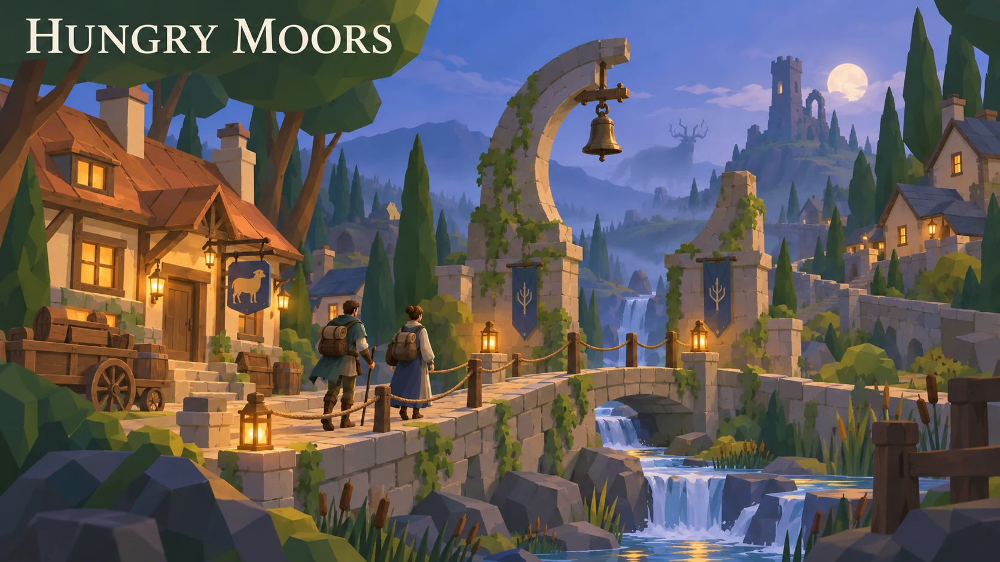
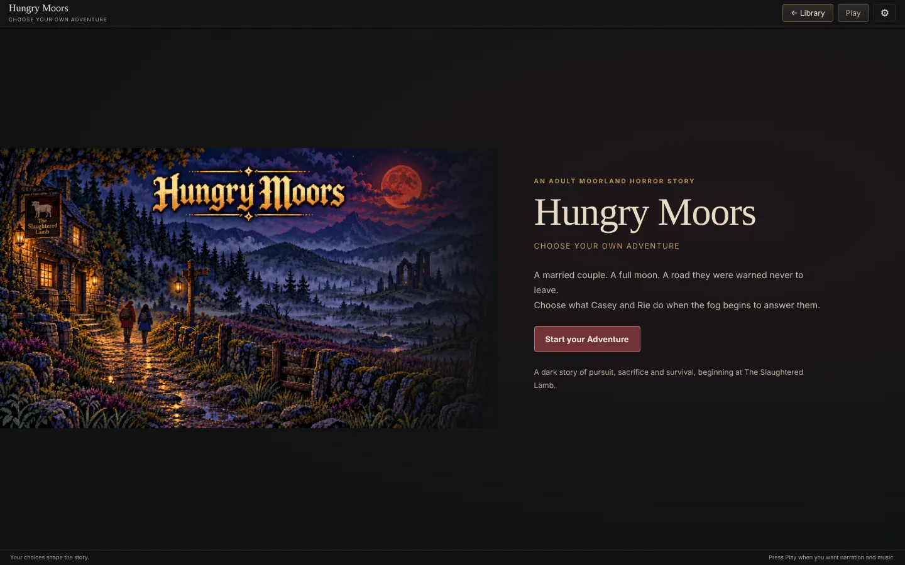
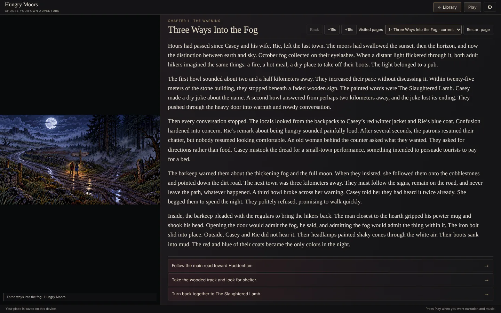
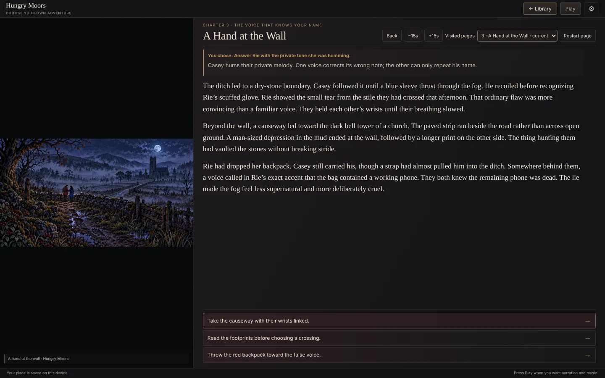
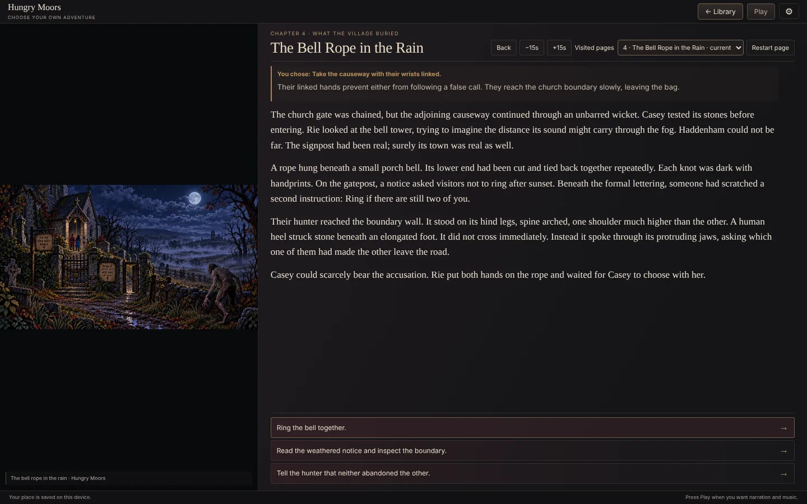
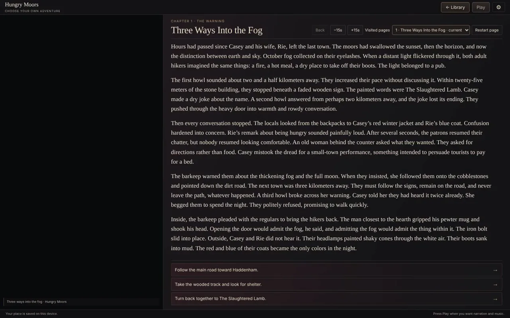

# Hungry Moors

**Two hikers, a full moon and a road they were warned never to leave.**

[**▶ Live demo**](https://beebopcat.github.io/hungry-moors/) · [**Play on caseyshingledecker.com**](https://caseyshingledecker.com/demos/top-secret/moorland-hikers/) · [**Source**](https://github.com/Beebopcat/hungry-moors)

[](https://beebopcat.github.io/hungry-moors/)

*Promotional cover art; gameplay screenshots appear below.*

## What it is

An adult moorland horror choose-your-own-adventure. A couple leave The Slaughtered Lamb for the moors, and 300 routes test what they will do to survive.

## Screenshots

| | |
|:--:|:--:|
|  |  |
| <sub>Hungry Moors cover with a moonlit village-road illustration, a Start your Adventure button and an adult-horror label.</sub> | <sub>Story reader on chapter Three Ways Into the Fog, with a moonlit road illustration, long narrative text and three choices.</sub> |
|  |  |
| <sub>Story reader on chapter A Hand at the Wall, with a misty moor illustration, a You chose note and three choices.</sub> | <sub>Story reader on chapter The Bell Rope in the Rain, with a village-gate illustration, a You chose note and three choices.</sub> |

### Video

[](docs/media/clip.mp4)

*Click the poster to open the short screen recording (docs/media/clip.mp4).*

## How to use

1. Choose Start your Adventure, or Continue your story.
2. Decide whether to trust a voice, keep a boundary or carry an account back, by picking one of the choices on each page.
3. Back lets you reconsider the previous choice.
4. Pause scene, Visited pages and Restart page are available while you read; narration offers -15s and +15s.
5. Switch Music and Voice on or off. The browser keeps your place.

### Quick start


<sub>Story reader on chapter A Hand at the Wall, with a misty moor illustration, a You chose note and three choices.</sub>

## Features

- 300 routes and twelve endings
- Illustrated pages
- Music and Voice toggles
- Your place is kept in the browser

## The story behind it

A married couple, a full moon and a road they were warned never to leave.

## Built with

- HTML and JavaScript

## Run it locally

This is a static web project, so any local web server works:

```bash
git clone https://github.com/Beebopcat/hungry-moors.git
cd hungry-moors
python -m http.server 8000
```

Then open http://localhost:8000 in your browser.

## Content notes

This is a work of dark fantasy and horror for adult readers. Content note: adult horror with injury, death and captivity.

## Credits & disclaimers

Built by Casey Shingledecker with AI-assisted development.

## More projects

- Portfolio and live demos: https://caseyshingledecker.com/
- All repositories: https://github.com/Beebopcat

## License

Copyright (c) 2026 Casey Shingledecker. All rights reserved. Source-available for viewing and for personal, non-commercial running only; this is not open source. See [LICENSE](LICENSE). See also [NOTICE.md](NOTICE.md). Other people's material keeps its own license.
